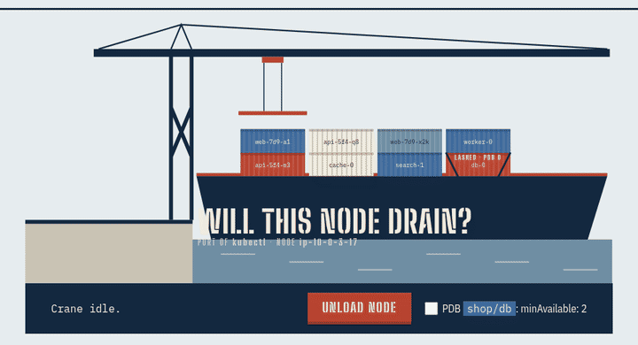

<p align="center"></p>

# drainready

**Will `kubectl drain` finish on this node?** Know before you cordon.

`kubectl drain` evicts pods through the Eviction API. When a PodDisruptionBudget allows 0 disruptions, the API answers `429` and drain **retries forever**. The message names the pod, not the budget. Managed node-group upgrades (EKS, AKS, GKE) stall for hours or fail. drainready reads the same pods and budgets up front, tells you which pods will block, and explains why: `minAvailable` equal to the replica count, `maxUnavailable: 0`, replicas already unhealthy, overlapping PDBs, bare pods, `emptyDir`.



Landing page: https://blackman99.github.io/drainready/ · Docs: https://blackman99.github.io/drainready/docs/

## Install

```bash
go install github.com/Blackman99/drainready/cmd/drainready@latest
```

Or download a single static binary for linux / macOS / windows from [Releases](https://github.com/Blackman99/drainready/releases).

## Usage

```console
$ drainready ip-10-0-3-17
BLOCKED  ip-10-0-3-17   9 pods: 5 ok, 1 wait, 0 need flag, 1 blocked, 2 skipped
   BLOCKED  shop/db-0         PDB shop/db allows 0 disruptions (healthy 2, needs 2, expected 2)
                              fix: minAvailable (2) equals the replica count (2): scale up first, or switch to maxUnavailable: 1
   WAIT     shop/web-7d9-x2k  2 pods of PDB shop/web are on this node but only 1 may go at once: drain waits for replacements to become ready elsewhere
$ echo $?
1
```

Check a whole node group with `-l eks.amazonaws.com/nodegroup=old`, or every node with `--all`. Add `--server-dry-run` to have the API server confirm each eviction (nothing is evicted). Use `--json` for scripts. Exit codes: `0` ready · `1` blocked · `3` needs `--force`/`--delete-emptydir-data` · `2` error.

Read-only. Needs `get/list` on nodes and pods and `list` on poddisruptionbudgets (plus `create` on `pods/eviction` for `--server-dry-run`).

CI runs the binary against a real kind cluster and cross-checks it with `kubectl drain --dry-run=server` ([test/e2e.sh](test/e2e.sh)).

See [GOAL.md](GOAL.md), [ROADMAP.md](ROADMAP.md), [CONTRIBUTING.md](CONTRIBUTING.md). MIT licensed.
